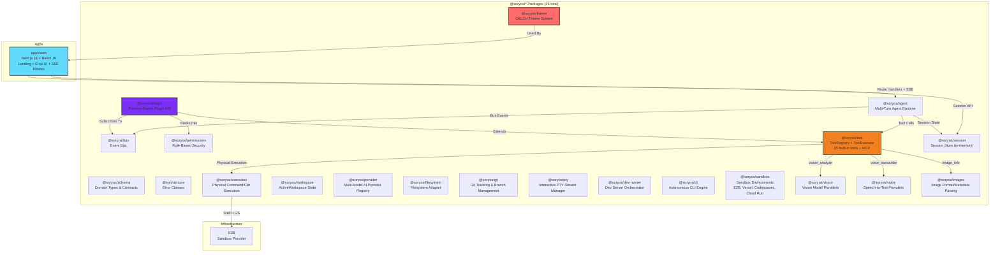
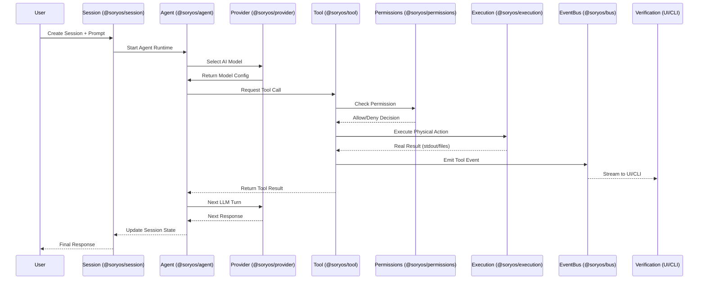
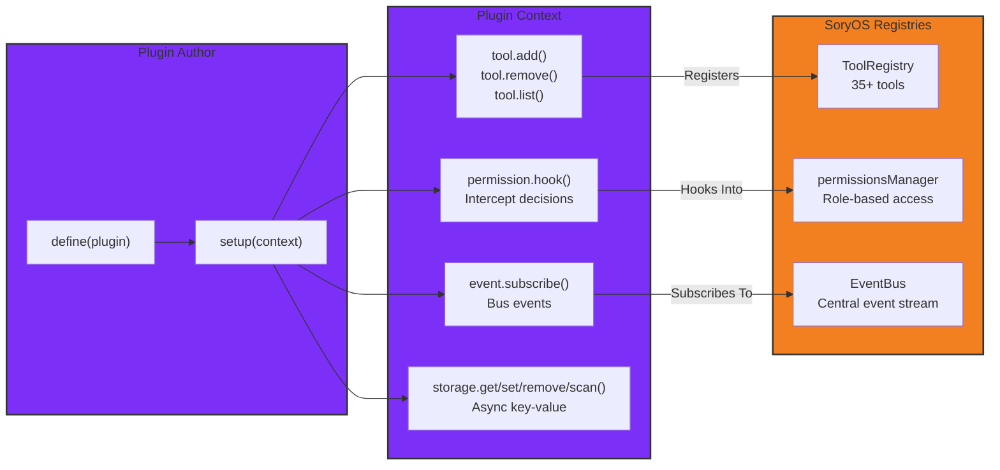

# SoryOS-Code

**Describe an app. Watch an agent build it — live.**


[](https://nodejs.org/)
[](https://nextjs.org/)
[](https://react.dev/)
[](https://turbo.build/)

---

SoryOS-Code is an AI coding workbench powered by an extensible **Sandbox Provider Architecture**. You describe what you want in natural language; an autonomous AI agent plans, writes files, runs commands, and verifies the result inside an isolated Sandbox Provider — while you follow every step in a Cursor-style interface.

No code generation in chat bubbles. Real files. Real terminal. Real preview.

## Multi-Provider Sandbox Architecture

SoryOS-Code abstracts code execution behind a unified `SandboxProvider` contract. You can seamlessly switch providers from a single interface:

- ☁️ **E2B** (`e2b`) — Remote cloud sandbox for complete development, terminal, processes, and builds.
- ☁️ **Vercel Sandbox** (`vercel`) — Cloud execution, builds, files, and commands.
- ☁️ **Google Cloud Run** (`google-cloud-run`) — Cloud execution & long-running build jobs (`cargo build`, `cmake`, `gcc`, ISO generation, cross-compilation).
- ☁️ **GitHub Codespaces** (`github-codespaces`) — Cloud development environment workspace.
- 💻 **Local** (`local`) — Local machine execution directly on the user's system.

## Stack

| Layer   | Tech                                                |
| ------- | --------------------------------------------------- |
| Web     | Next.js 16, React 19, Tailwind 4, shadcn/ui, Monaco |
| API     | Next.js route handlers (App Router) + SSE streaming |
| Agent   | `@soryos/agent` runtime + `@soryos/provider` (Gemini, OpenAI, Mistral, Zen) |
| Runtime | `@soryos/execution` — local, E2B, Vercel, Codespaces, Cloud Run |
| Plugins | `@soryos/plugin` (Promise-based plugin authoring API) |

## Architecture

### Monorepo Layout



### End-to-End Execution Pipeline



### Plugin System Architecture



## Request Flow

1. User creates a session with an initial prompt → stored in `@soryos/session` (in-memory; a server restart loses sessions — no durable DB yet).
2. `POST /api/sessions/:id/run` invokes the agent inline in the Next.js route handler.
3. Agent uses sandbox tools; the route streams text and tool events to the UI in real time via SSE.
4. Assistant + tool rows are written to the session store; reload restores full history while the process is alive.
5. Demo tab calls `GET /preview` to ensure the dev server is up.

## Quick start

**Prerequisites:** Node 20+, npm, and at least one AI provider key ([Gemini](https://aistudio.google.com/), [OpenAI](https://platform.openai.com/), [Mistral](https://console.mistral.ai/)) plus optionally an [E2B](https://e2b.dev/) key.

```bash
git clone <repo-url> soryos-code && cd soryos-code
make install      # npm install (turbo workspaces)
```

Add your keys to `.env` (see `.env.example`):

```env
GEMINI_API_KEY=...
E2B_API_KEY=...
```

```bash
make dev          # web → :3000
```

Open [http://localhost:3000](http://localhost:3000), describe an app, and follow the agent in the workspace.

## Environment

| Variable              | Description                                           |
| --------------------- | ----------------------------------------------------- |
| `GEMINI_API_KEY`      | Google Gemini provider (vision + chat)                |
| `OPENAI_API_KEY`      | OpenAI provider (vision + chat)                       |
| `MISTRAL_API_KEY`     | Mistral provider (vision + chat)                      |
| `ANTHROPIC_API_KEY`   | Anthropic provider (vision)                           |
| `E2B_API_KEY`         | E2B sandbox API key                                   |
| `GOOGLE_SPEECH_API_KEY` / `AZURE_SPEECH_KEY` | Speech-to-text providers            |
| `E2B_TEMPLATE_ID`     | Sandbox template                                      |

## API

| Method | Path                            | Purpose                                        |
| ------ | ------------------------------- | ---------------------------------------------- |
| `GET`  | `/api/sessions`                 | List sessions                                  |
| `POST` | `/api/sessions`                 | Create session (+ optional first message)      |
| `GET`  | `/api/sessions/:id`             | Session state + UI messages (with tool blocks) |
| `POST` | `/api/sessions/:id/run`         | Resume agent on last user message (SSE)        |
| `POST` | `/api/sessions/:id/messages`    | New user turn (SSE)                            |
| `POST` | `/api/sessions/:id/abort`       | Stop running agent                             |
| `GET`  | `/api/sessions/:id/files`       | Project file tree from sandbox                 |
| `GET`  | `/api/sessions/:id/files/:path` | Read file content                              |
| `GET`  | `/api/sessions/:id/preview`     | Ensure dev server; return preview URL          |
| `POST` | `/api/sessions/:id/terminal`    | Run shell command in sandbox                   |

SSE events: `status`, `text`, `tool_start`, `tool_end`, `preview`, `files_changed`, `done`, `error`.

## Plugin System

SoryOS-Code supports a Promise-based plugin API for extending the system:

```typescript
import { define } from "@soryos/plugin";
import type { PluginContext } from "@soryos/plugin";

export default define({
  id: "my-custom-plugin",
  setup: async (context: PluginContext) => {
    // Register a custom tool
    context.tool.add({
      id: "custom_greeter",
      name: "custom_greeter",
      description: "Greets the user with a custom message",
      category: "agent",
      parameters: {
        type: "object",
        properties: {
          name: { type: "string", description: "Name to greet" },
        },
        required: ["name"],
      },
    }, async (args, ctx) => {
      return {
        toolName: "custom_greeter",
        output: `Hello, ${args.name}!`,
        isError: false,
      };
    });

    // Hook into permission evaluation
    await context.permission.hook((evaluation) => {
      if (evaluation.toolName === "dangerous_tool") {
        evaluation.effect = "deny";
      }
    });

    // Subscribe to bus events
    await context.event.subscribe((event) => {
      if (event.type === "tool.completed") {
        // Handle tool completion
      }
    });

    // Return cleanup function
    return () => {
      // Cleanup logic
    };
  },
});
```

## Project structure

```
soryos-code/
├── apps/
│   └── web/                 Next.js frontend + API routes
│       ├── app/             Landing + /chat/[id]
│       ├── app/api/         REST + SSE routes (sessions, run, messages, terminal, mcp…)
│       ├── components/      Chat, preview, terminal, sidebar
│       └── lib/             API client, chat blocks, types, sse-helper
├── packages/
│   ├── schema               Domain types & contracts
│   ├── core                 Error classes
│   ├── bus                  EventBus streaming
│   ├── permissions          Role-based security
│   ├── execution            Physical command/file execution
│   ├── tool                 ToolRegistry + ToolExecutor (35 tools)
│   ├── agent                Multi-turn agent runtime
│   ├── vision               Multi-provider vision analysis
│   ├── voice                Speech-to-text transcription
│   ├── images               Image format/metadata parsing
│   ├── plugin               Promise-based plugin API
│   ├── theme                OKLCH theme system
│   ├── sandbox              E2B, Vercel, Codespaces, Cloud Run
│   └── ...                  (26 packages total)
├── .env.example
├── Makefile
└── package.json             npm + turbo monorepo
```

## Development

```bash
make dev          # web (Next.js on :3000)
make lint         # eslint
make build        # turbo build
npm run typecheck # tsc (turbo) — 0 errors required
npm run test:engine  # engine test suite (permissions, provider, tool, execution, agent, plugin, theme)
```

## CLI (`@soryos/cli`)

The SoryOS-Code CLI is a standalone engine that runs the **same `@soryos/agent` runtime** as the Next.js web app — no duplicate implementation. It shares the exact code path: session store → agent runtime → tools → execution provider → event bus. The only difference is the event sink: the web app streams events via SSE routes, while the CLI renders them to stderr/stdout.

### Launching it

```bash
# 1. From the repo root (no install needed)
npm run cli -- --help
npm run cli -- interactive

# 2. Via the workspace binary (already linked in node_modules/.bin)
./node_modules/.bin/soryos-code interactive

# 3. Globally, from any directory
cd packages/cli && npm link
soryos-code interactive
```

`npm run cli -- <args>` forwards everything after `--` to the CLI, so
`npm run cli -- run "fix the bug"` works as expected.

### Credentials

The agent needs a real provider key in the environment (checked by `soryos-code auth`):

```bash
export GEMINI_API_KEY=...   # or GOOGLE_API_KEY / OPENAI_API_KEY / MISTRAL_API_KEY
```

Without a key the CLI fails **honestly** (exit code 1) instead of pretending to work.

```bash
# Help
npx tsx packages/cli/src/index.ts --help

# Interactive terminal session (REPL) — same as running the CLI with no args
npx tsx packages/cli/src/index.ts interactive
npx tsx packages/cli/src/index.ts i            # alias
npx tsx packages/cli/src/index.ts chat         # alias

# Run a single prompt (non-interactive)
npx tsx packages/cli/src/index.ts run "build a todo app"

# Piped prompt
echo "refactor the auth module" | npx tsx packages/cli/src/index.ts run

# Session management (disk-backed, persists across runs)
npx tsx packages/cli/src/index.ts session list
npx tsx packages/cli/src/index.ts session export <id>
npx tsx packages/cli/src/index.ts session import file.json
npx tsx packages/cli/src/index.ts session delete <id>

# Other commands
npx tsx packages/cli/src/index.ts models
npx tsx packages/cli/src/index.ts auth
npx tsx packages/cli/src/index.ts plugin
npx tsx packages/cli/src/index.ts debug paths
npx tsx packages/cli/src/index.ts debug config
```

### Interactive mode (terminal REPL)

```bash
npx tsx packages/cli/src/index.ts interactive
```

```
SoryOS-Code interactive
Session: cli-1792499056969-3ouvur  Agent: build  Model: gemini-3.8-flash
Type /help for slash commands, /exit to quit.

┃ soryos › analyse le repo et propose un plan
● Agent started
Analyse de la demande…
⚙ glob_files
✔ glob_files
✔ Task finished

┃ soryos › /model
╭ Select a model ──────────────────────────────────────────────────────╮
│ Filter: ▌                                                            │
│   Google Gemini                                                      │
│ ❯ Gemini 3.8 Flash — Google Gemini · gemini-3.8-flash (current)      │
│   Gemini 3.0 Pro — Google Gemini · gemini-3.0-pro                    │
│ ↑/↓ navigate · type to filter · enter select · esc cancel            │
╰──────────────────────────────────────────────────────────────────────╯

┃ soryos › /exit
```

- Prompt `┃ soryos ›` (bordure gauche, comme opencode), **historique** (flèches haut/bas)
- `Ctrl+C` efface la ligne courante, sort sur une ligne vide (code `130`) · `Ctrl+D` sort (`0`)
- Slash commands : `/help` `/exit` `/new` `/model` `/provider` `/agent` `/auth` `/sessions` `/clear`
- `/model` et `/provider` ouvrent un **picker** avec **champ de recherche** (tapez pour filtrer), ↑/↓, Entrée
- **Tactile / souris** : un tap (ou un clic) sur une option la sélectionne, la molette fait défiler ; le tap positionne aussi le curseur dans la ligne de saisie
- **Adaptatif** : la boîte suit la largeur du terminal (bordures toujours alignées, texte tronqué), se rétrécit sur mobile et se redessine à la rotation
- Chaque tour est persisté dans `.soryos/cli-sessions/<id>.json`
- Refusé honnêtement hors TTY (pas de repli silencieux)

### Models

```bash
soryos-code models              # the 56 models of the registry, grouped by provider
```

One single source of truth: `@soryos/provider`'s `SUPPORTED_AI_MODELS`
(15 Google · 16 OpenRouter · 5 OpenAI · 4 Anthropic · 4 DeepSeek · 3 Mistral
· 4 OpenCode Zen · 2 Grok · 2 Cursor). The `models` command, the `/model`
picker and the agent's `models` tool all read it.

### OpenCode Zen — free tier par clé publique

`@soryos/provider` embarque le **catalogue réel** de la passerelle opencode.ai
(120 modèles dans le catalogue statique, **rafraîchi en direct** depuis
`GET opencode.ai/inference/v1/models` → 85 modèles servis à l'instant T) :

```bash
soryos-code auth switch opencode-zen   # provider actif
soryos-code run "..." --model big-pickle
```

- Sans clé personnelle, la passerelle reçoit la clé publique `public`
- Le picker ne propose alors que les **modèles gratuits** (les payants sont
  marqués « key required »)
- ⚠️ La passerelle réserve le free tier à son client officiel (erreur
  `403 FreeTierError`) : le message est remonté tel quel, avec la solution
  (`soryos-code auth login opencode-zen` ou un autre provider)

### Provider credentials (`soryos-code auth`)

```bash
soryos-code auth list                 # état de chaque provider
soryos-code auth login google          # picker + saisie masquée → stockage disque
soryos-code auth logout google         # supprime la clé stockée
soryos-code auth switch openai         # provider actif par défaut
```

- La clé est écrite dans `~/.soryos/credentials.json` (global, permissions **0600**) → elle marche depuis n'importe quel dossier
- Un fichier projet `.soryos/credentials.json` peut surcharger
- Résolution : **provider actif → clé stockée → variables d'environnement**
- Si le provider actif n'a pas de clé → erreur honnête (pas de bascule silencieuse)
- Le **modèle suit le provider** (le modèle par défaut du provider est utilisé)
- La clé stockée est **réellement utilisée** par l'agent (`@soryos/credentials`)

### Output Conventions (opencode-style)

- **stdout = DATA only** (NDJSON `--format json`, lists, exports)
- **stderr = chrome** (progress, errors, human rendering)
- **Exit codes**: `0` ok · `1` error · `130` SIGINT
- **`--format json`** → NDJSON events with `{type, timestamp, sessionId, ...}` envelope

### `run` / `interactive` Flags

| Flag | Alias | Description |
|------|-------|-------------|
| `--session` | `-s` | Session id (created if missing) |
| `--continue` | `-c` | Resume the most recent session |
| `--fork` | — | Fork a copy of the target session |
| `--model` | `-m` | Model id (e.g. `gemini-2.5-flash`) |
| `--agent` | — | Agent role: `build` \| `plan` \| `explore` \| `code-reviewer` |
| `--format` | — | `default` \| `json` |
| `--auto` | — | Auto-approve permission prompts |
| `--title` | — | Session title |

### Shared Engine with the Web App

```
CLI run/interactive → @soryos/agent (runPipeline) → @soryos/tool → @soryos/execution → @soryos/bus → events
Web run/messages    → @soryos/agent (runPipeline) → @soryos/tool → @soryos/execution → @soryos/bus → SSE routes
```

`runPipeline()` (in `@soryos/agent`) is the single place that prepares the session, appends the user message and calls `agentRuntime.run()`. The only difference is the event sink. See `packages/cli/AGENTS.md` for full details.

### Shared CLI/GUI Interface — roadmap
`docs/plans/cli-gui-shared-interface.md` — **all phases done**:
1. ✅ `runPipeline` extracted into `@soryos/agent` (Phase 1)
2. ✅ The CLI is a thin adapter over it (`framework/engine.ts` + `framework/render.ts`)
3. ✅ The web app uses the same function and streams the same events over SSE
4. ✅ Shared session resolution (`--session/--continue/--fork`) in `@soryos/session` (Phase 2)
5. ✅ Canonical event contract `SoryOSEvent` + questions/permissions parity (Phase 3)
6. ✅ Parity test harness + CI guard: no adapter may call `agentRuntime.run()` (Phase 4)

## What's Ported from OpenCode

| Feature | OpenCode | SoryOS-Cloud | Status |
|---------|----------|--------------|--------|
| Real-time Sync | Convex subscriptions | Next.js SSE routes + `@soryos/bus` | ✅ Complete (in-memory store; durable DB not implemented) |
| Background Jobs | Inngest queue | None — never implemented, removed | ❌ Not implemented |
| Sandbox Execution | E2B SDK | `@soryos/sandbox` with E2B provider | ✅ Complete |
| Error Recovery | onFailure handler | Error classification system | ✅ Complete |
| Multi-provider | E2B only | E2B, Vercel, Codespaces, Cloud Run | ✅ Already exists |
| Session Management | Convex | `@soryos/session` (in-memory) | ⚠️ Complete in-process; lost on restart |
| Plugin System | @opencode/plugin | `@soryos/plugin` (Promise API) | ✅ Complete |
| Theme System | @opencode/theme | `@soryos/theme` (OKLCH) | ✅ Complete |
| 35+ Tools | opencode tools | `@soryos/tool` registry | ✅ Complete |
| Multi-AI Provider | ❌ (Claude only) | ✅ Gemini, OpenAI, Mistral, Zen | ✅ Enhanced |
| Template System | ✅ | ✅ Expo, Next.js templates (E2B) | ✅ Enhanced |
| Auto-Pause/Resume | ✅ | ✅ Enhanced with session tokens | ✅ Enhanced |
| Cost Tracking | ✅ | ✅ Token + Credit systems | ✅ Enhanced |
| GitHub Integration | ✅ | ✅ Auto-push support | ✅ Enhanced |
| OCC Retry | ✅ | ✅ Exponential backoff | ✅ Enhanced |
| Ownership Verification | ✅ | ✅ All queries secured | ✅ Enhanced |